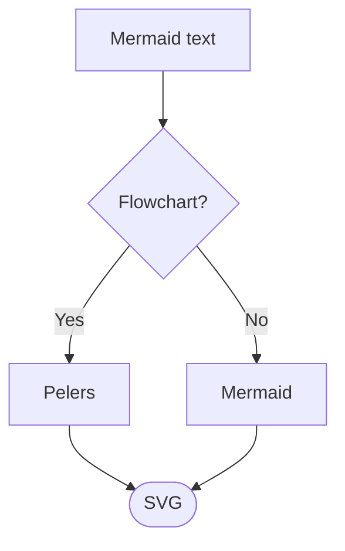

# Pelers

Pelers is a lightweight [open source](https://github.com/farhnkrnapratma/pelers) library that renders [Mermaid](https://mermaid.js.org) diagrams to SVG. Its colors and fonts come from [CSS variables](/docs/theming), so a theme change does not require rendering again.

Pelers is a Rust rewrite of [Pele](https://github.com/obsidianmd/pele), a Mermaid renderer by [kepano](https://github.com/kepano) that is released under the MIT License. Pelers ports Pele's diagram types one by one and keeps the MIT License. See [Credits](#credits) below.

## How it works

Pass Mermaid text, get an SVG string back:

```ts
import { render } from 'pelers';

const svg = render('flowchart LR\n  A --> B');
```

### Mermaid



### CSS

```css
.pelers {
  --pelers-bg: #fffcf0;
  --pelers-fg: #100f0f;
  --pelers-muted: #6f6e69;
  --pelers-line: #100f0f;
  --pelers-surface: #f2f0e5;
  --pelers-surface-alt: #e6e4d9;
  --pelers-border: #cecdc3;
}
```

## Install

```sh
bun add pelers          # JavaScript / TypeScript (native addon for Node and Bun)
cargo add pelers        # Rust
```

## Status

Pelers is alpha. All 33 Mermaid diagram types are ported. Output is compared with Pele 1.13.0 on sample inputs; see [Compatibility](/docs/compatibility) for what that comparison covers.

## Credits

- **Pele** by [kepano](https://github.com/kepano) (Obsidian), MIT License. Pelers is a rewrite of Pele's renderer and keeps Pele's copyright notice in [NOTICE](https://github.com/farhnkrnapratma/pelers/blob/main/NOTICE).
- **Mermaid** by the Mermaid project, MIT License. Pelers uses Mermaid's syntax as its input language.
